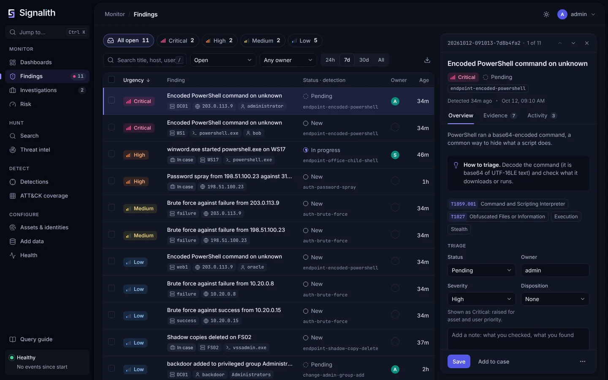

# Signalith

[](https://www.bestpractices.dev/projects/15694)
[](LICENSE)
[](https://github.com/jrsamsanchez/Signalith/releases/latest)

**A free, open-source SIEM for Windows and Linux: easy to set up, easy to query, ready for AI.**



Signalith collects your logs, runs thousands of tested detections over them, and gives
you one queue of findings to triage, investigate and respond to. It is built for small
security teams and anyone who wants a real SIEM without a big budget or weeks of setup.

- **Collect** Windows, Linux and macOS logs with one install line per computer, plus
  syslog, OpenTelemetry, cloud audit logs (AWS, Azure, Microsoft 365, Google) and more.
- **Detect** with 2,644 SigmaHQ rules and 1,330 rules from Splunk's open-source
  security_content, each tested in CI against sample events, tagged with 181 ATT&CK
  techniques. High and critical rules turn on in one click. Signalith also ships 60
  built-in detections (brute force, password spray, encoded PowerShell, credential
  dumping and more); 55 are on by default.
- **Triage** with risk-based alerting, a findings queue, cases, an attack storyline and
  an optional *Investigate with AI* step that also works with a local model.
- **Search** with a pipe-style language familiar to SPL users, a click-to-build query
  builder, or a question in plain English.
- **Run it your way**: Docker, `.deb`/`.rpm` packages with signed apt and dnf
  repositories, a Windows installer, or a Helm chart. HTTPS by default, no default
  passwords, and two-step sign-in with passkeys.

| Try it | |
| --- | --- |
| In your browser, nothing to install | [demo.signalith.io](https://demo.signalith.io), a read-only demo with the sample data |
| On your own computer, with Docker | [Quick start](#quick-start), two commands after `git clone` |
| With made-up data that has attacks hidden in it | [Sample data](https://signalith.io/docs/sample-data/), one click |
| On a Linux or Windows server | [Packages](https://signalith.io/docs/install-packages/) (`.deb`, `.rpm`, `.msi`), [Linux](https://signalith.io/docs/getting-started/#linux), [Windows](https://signalith.io/docs/getting-started/#windows), [Kubernetes](https://signalith.io/docs/kubernetes/) |

**Learn more:** [website](https://signalith.io) ·
[documentation](https://signalith.io/docs/) ·
[how it compares](https://signalith.io/docs/comparison/) with Wazuh, Security Onion,
Elastic Security and others, including where it is weaker ·
[roadmap](https://signalith.io/docs/roadmap/)

> Signalith is a personal project by Samuel Sanchez Jr., written with Claude Code, and
> it is early software: it has not had an independent security audit yet, and the
> Windows installer is not code signed yet. Issues and feedback are welcome.

## What's inside

Signalith stores events in [OpenSearch](https://opensearch.org) (2.17 or newer, 3.x
included) and collects them with the [Signalith Agent](docs/signalith-agent.md), which
installs and runs [Fluent Bit](https://fluentbit.io) and [osquery](https://osquery.io) on
Windows, Linux and macOS, and with syslog, OpenTelemetry and cloud connectors. On top it
adds a pipe-based query language, plain-English questions that become queries, a visual
query builder, CIM-style data models, scheduled detections with a findings queue, Sigma
rule import, an ATT&CK coverage map, risk-based alerting with asset and identity context,
threat intel feeds, dashboards, investigation cases, response actions and playbooks.

The server is a single Go binary with the web UI embedded. It runs as a Windows service,
a systemd unit or a container.

> Status: working toward 1.0. Until then the work goes into correctness, upkeep and proof
> rather than new features; the [roadmap](https://signalith.io/docs/roadmap/) has the 1.0
> checklist.

## Quick start

It needs Docker Compose 2.20 or newer (Docker Desktop has it). Get the code and start it:

```sh
git clone https://github.com/jrsamsanchez/Signalith.git
cd Signalith
docker compose -f deploy/docker/docker-compose.yml up -d
docker compose -f deploy/docker/docker-compose.yml exec signalith signalith initial-password
```

The last command shows the admin password. Open https://localhost:9000 and sign in as
`signalithadmin`; you then choose your own password. The browser warns about the
certificate until you trust it ([how](https://signalith.io/docs/https/#trust-the-certificate)).
Then open **Add data** to install the agent on your computers, or load the sample data.

[Docker quick start](https://signalith.io/docs/docker/) covers ports, updates, running a
release and upgrading an older quick start.

## Documentation

| | |
| --- | --- |
| Install | [Getting started](https://signalith.io/docs/getting-started/) · [Packages](https://signalith.io/docs/install-packages/) · [Supported platforms](https://signalith.io/docs/platforms/) · [Kubernetes](https://signalith.io/docs/kubernetes/) · [More than one server](https://signalith.io/docs/multi-server/) |
| Collect | [Agents and syslog](https://signalith.io/docs/sending-data/) · [Signalith Agent](https://signalith.io/docs/signalith-agent/) · [OpenTelemetry](https://signalith.io/docs/opentelemetry/) · [Any other log](https://signalith.io/docs/custom-logs/) |
| Detect and respond | [Detections](https://signalith.io/docs/detections/) · [Cases](https://signalith.io/docs/cases/) · [Investigate with AI](https://signalith.io/docs/investigate/) · [Response actions](https://signalith.io/docs/response-actions/) · [Playbooks](https://signalith.io/docs/playbooks/) |
| Search | [Query language](https://signalith.io/docs/query-language/) · [Dashboards](https://signalith.io/docs/dashboards/) · [Hunting notebooks](https://signalith.io/docs/hunting-notebooks/) |
| Run it safely | [Security checks](https://signalith.io/docs/security/) · [HTTPS](https://signalith.io/docs/https/) · [Users and roles](https://signalith.io/docs/users/) · [Encryption](https://signalith.io/docs/encryption/) · [Threat model](https://signalith.io/docs/threat-model/) · [Outbound connections](https://signalith.io/docs/outbound/) · [Where your data goes](https://signalith.io/docs/data-residency/) |
| Run it day to day | [Configuration file](https://signalith.io/docs/configuration/) · [Settings page](https://signalith.io/docs/settings/) · [Data retention](https://signalith.io/docs/retention/) · [Backup and restore](https://signalith.io/docs/backup/) |

## Building

Requires the Go version in `go.mod` or newer:

```sh
go build -o signalith ./cmd/signalith
```

[CONTRIBUTING.md](CONTRIBUTING.md) has the tests, code style and how to send changes;
[GOVERNANCE.md](GOVERNANCE.md) says who maintains the project.

## License

[Apache 2.0](LICENSE). See [NOTICE](NOTICE) for third-party data.

## Trademarks

Signalith is an independent open-source project. It is not affiliated with,
endorsed by or sponsored by Splunk or Cisco, and contains no Splunk software code.
Its optional Splunk Security Content pack ships detection rules from Splunk's open
source security_content project under the Apache License 2.0 (see NOTICE).
Splunk, Splunk Enterprise Security and SPL are trademarks or registered trademarks
of Splunk LLC, a Cisco company, in the United States and other countries; they are
named here only to describe the rules Signalith can run and its search syntax. OpenSearch, Fluent Bit,
Sigma and MITRE ATT&CK are trademarks of their respective owners.
